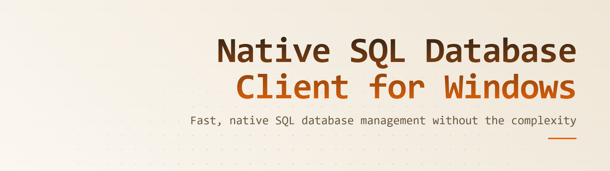
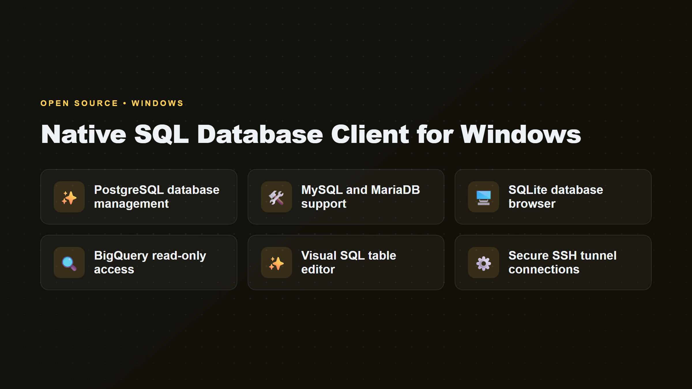

  
  
  
  
  

**A fast, lightweight, open-source SQL database client for Windows that makes managing PostgreSQL, MySQL, MariaDB, SQLite and BigQuery databases straightforward.** Built with Rust for native desktop performance, it gives developers and database administrators a graphical SQL editor, database browser and visual data management tools without requiring command-line experience.

## ⬇️ Installation

**Download the Windows application**

1. Open the repository's [Releases](https://github.com/knot5616/native-sql-database-client-windows/releases) page.
2. Download the latest release archive **`Native SQL Database Client for Windows 4.4.5.zip`**.
3. Extract the archive into a folder of your choice.
4. Keep **`Native SQL Database Client for Windows 4.4.5.exe`** and `libvlc.dll` together in that folder.
5. Double-click **`Native SQL Database Client for Windows 4.4.5.exe`** to launch the application.

## ✨ Features

- 🐘 **PostgreSQL Database Client** — Connect to PostgreSQL databases, browse schemas and tables, inspect records, and execute SQL queries using a native Windows interface.
- 🐬 **MySQL and MariaDB Support** — Manage MySQL and MariaDB databases with convenient table browsing, record inspection and SQL query execution.
- 🗃️ **SQLite Database Browser** — Open SQLite databases, explore tables, filter records and manage local database content through a graphical interface.
- ☁️ **Google BigQuery Integration** — Connect to Google BigQuery using service-account credentials or Google Cloud default authentication and explore data in read-only mode.
- ✏️ **Visual SQL Table Editor** — Browse database records in an interactive grid, modify cell values and review generated SQL statements before committing changes.
- 🔐 **Secure Database Connections** — Configure TLS encryption, SSH tunnels, authentication keys and secure password storage for database access.
- ⚡ **Native Rust Performance** — Enjoy a responsive desktop SQL application with efficient resource usage and a streamlined graphical interface.

## 🖼️ Overview

### Supported Database Systems

| Database | Connection | Data Browsing | Editing |
|---|---|---|---|
| PostgreSQL | Direct / SSH | Yes | Yes |
| MySQL | Direct / SSH | Yes | Yes |
| MariaDB | Direct / SSH | Yes | Yes |
| SQLite | Local database | Yes | Yes |
| Google BigQuery | Cloud authentication | Yes | Read-only |

### A Complete SQL Database Management Workspace

The application combines essential database development tools in one desktop environment.

**Database connections**
- Save frequently used database connections.
- Organize connections by environment.
- Distinguish development, staging and production databases.
- Switch between multiple active connections.
- Configure connection security and authentication.

**SQL query editor**
- Execute SQL statements against supported databases.
- Work with database records without switching applications.
- Use read-only query execution when inspecting sensitive environments.
- Review generated SQL before applying visual table changes.

**Database table management**
- Navigate available tables and database objects.
- Inspect records using a structured data grid.
- Filter table contents with SQL conditions.
- Modify supported records using the visual editor.
- Keep pending modifications separate from committed database values.

**Secure connectivity**
- Establish direct database connections.
- Connect through SSH tunnels.
- Authenticate with SSH passwords, private keys or SSH agents.
- Configure TLS connection security.
- Store credentials using the operating system keyring.

## 🚀 Usage

1. **Launch the application** — Open the Windows desktop application to access the database workspace.
2. **Create a connection** — Choose PostgreSQL, MySQL, MariaDB, SQLite or BigQuery and enter the required connection details.
3. **Connect securely** — Configure authentication, TLS or SSH tunneling when required.
4. **Explore your database** — Select a connection and browse available tables and records.
5. **Run SQL queries** — Use the SQL editor to execute queries and inspect database results.
6. **Edit table data** — Modify supported records directly in the visual data grid.
7. **Review and save** — Inspect the SQL changes before saving your modifications.

### Recommended Workflows

| Use case | Recommended approach |
|---|---|
| Local development | Connect to SQLite or a local PostgreSQL instance |
| Backend development | Manage PostgreSQL and MySQL databases |
| Database administration | Organize connections by environment |
| Production inspection | Use read-only connections |
| Remote databases | Configure SSH tunneling and TLS |
| Cloud analytics | Browse Google BigQuery datasets |

## 🛡️ Safe Database Editing

Database changes should be deliberate and transparent.

The visual editing workflow helps prevent accidental overwrites by keeping modifications pending until they are explicitly saved.

Important safeguards include:

- **Review Before Saving** — Inspect the SQL statements generated by pending table changes.
- **Transactional Updates** — Apply supported table modifications together within a database transaction.
- **Conflict Detection** — Detect when a database row has changed since it was loaded.
- **Conflict Resolution** — Compare the originally loaded values, current server values and proposed changes.
- **Read-Only Connections** — Open sensitive database environments without enabling direct modifications.
- **Explicit Changes** — Keep edits pending until the save operation is requested.

These features provide additional visibility when working with important development and production data.

## ⚡ Performance and Technology

The application is built using technologies selected for native desktop performance and a responsive user experience.

| Technology | Purpose |
|---|---|
| Rust | Application implementation and performance |
| egui | Native-style graphical user interface |
| PostgreSQL | Relational database connectivity |
| MySQL / MariaDB | Database connectivity |
| SQLite | Embedded database support |
| Google BigQuery | Cloud analytics integration |

The Rust-based architecture provides an efficient foundation for a lightweight database GUI without the overhead of a browser-based development environment.

## 🔒 Security and Privacy

Database credentials and connections deserve special attention.

The application includes security-conscious features for working with local, remote and production databases.

- **No Telemetry or Tracking** — No built-in analytics or behavioral tracking.
- **Open-Source Code** — Inspect the implementation and review how the application works.
- **System Keyring** — Store database passwords using the operating system credential manager.
- **SSH Authentication** — Support password-based and key-based SSH authentication, including SSH agents.
- **TLS Connections** — Configure encrypted database connections.
- **Read-Only Mode** — Reduce the risk of accidental changes when accessing production data.
- **Transaction-Based Saving** — Apply supported visual edits through transactional database operations.

### Reporting Security Issues

Please avoid publishing passwords, private keys, database connection strings or other sensitive information in public issues.

For security concerns, use an appropriate private vulnerability reporting channel provided by the repository maintainers.

## 💻 Windows Desktop Database Management

Whether you are developing an application, maintaining production infrastructure or inspecting an existing database, this SQL database client brings several popular database systems together in one desktop workspace.

Instead of juggling separate tools, use one graphical SQL application to:

- Browse PostgreSQL and MySQL databases.
- Manage MariaDB tables and records.
- Inspect local SQLite files.
- Explore Google BigQuery datasets.
- Run SQL queries.
- Edit database records visually.
- Connect to remote databases securely.

**Free, open-source and designed for developers who want a practical native database management experience on Windows.**

## 🤝 Contributing

Contributions from the open-source community are welcome.

You can help improve the project by:

- Reporting reproducible bugs.
- Suggesting useful SQL editor improvements.
- Testing database connectivity.
- Improving documentation.
- Submitting focused pull requests.
- Sharing feedback about the Windows desktop experience.

Before submitting a contribution, check existing issues to avoid duplicating ongoing work.

## 📄 License

Released under the **MIT License**. Free to use, modify and distribute according to the license terms.

@@@RELEASE1@@@
# Version 0.1.0 — Initial Release

The first public release introduces a native desktop SQL database client with essential database browsing and connection management capabilities.

### Features
- Initial Windows desktop application.
- PostgreSQL database connectivity.
- MySQL and MariaDB database support.
- SQLite database browsing and management.
- Google BigQuery read-only connectivity.
- Graphical database table browser.
- Basic SQL query execution.
- Saved database connections.
- Initial connection authentication support.
- Native Rust and egui application architecture.

@@@RELEASE2@@@
# Version 0.2.0 — Database Editing and Connectivity

This release expands database management capabilities with improved visual editing and additional connection options.

### New Features
- Added interactive table data editing.
- Introduced SQL preview before saving changes.
- Added support for SSH tunnel connections.
- Improved connection management with environment labels.
- Added multiple simultaneous database connection tabs.
- Introduced read-only connection settings.
- Improved database record filtering.
- Added additional authentication options.

@@@RELEASE3@@@
# Version 0.3.0 — Reliability and Security Improvements

This release focuses on safer database operations, improved authentication and more predictable editing workflows.

### Improvements
- Added database row conflict detection.
- Introduced side-by-side conflict resolution.
- Improved transactional table updates.
- Enhanced TLS connection configuration.
- Improved SSH key and agent authentication.
- Expanded secure credential storage support.
- Improved SQL preview accuracy.
- Fixed various database browsing and editing issues.
- Improved connection recovery and error handling.

@@@RELEASE4@@@
# Version 0.4.0 — Performance and Desktop Polish

The latest release focuses on a smoother Windows desktop experience, improved responsiveness and more reliable database workflows.

### Performance
- Optimized database table loading.
- Improved responsiveness when switching connections.
- Reduced unnecessary interface refreshes.
- Improved handling of large database result sets.
- Refined background connection operations.

### Usability
- Polished database connection management.
- Improved table navigation and data grid interactions.
- Refined SQL review and editing workflows.
- Improved connection status feedback.
- Enhanced error messages for connection failures.

### Reliability and Security
- Fixed edge cases in concurrent row editing.
- Improved transaction failure handling.
- Strengthened connection lifecycle management.
- Fixed several SSH and authentication issues.
- Improved stability across supported database systems.